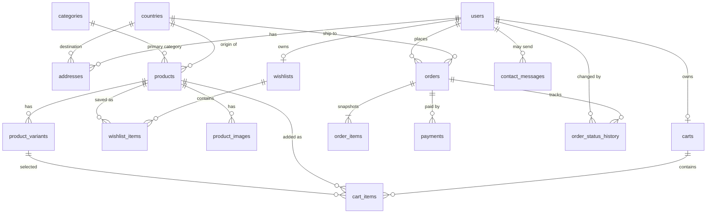

# GloFe database design

Target: MySQL 8.0.16+ (8.4 LTS recommended), InnoDB, `utf8mb4`. Files: `database/schema.sql`, `database/seed.sql`.

## ER diagram

(`sessions` is a standalone table used by the session store.)

## Relationships and deletion behaviour

| Relationship | On delete | Why |
|---|---|---|
| addresses → users | CASCADE | Deleting an account removes its saved addresses |
| carts, wishlists → users | CASCADE | Cart/wishlist have no value without the user |
| cart_items → carts | CASCADE | |
| cart_items → products / product_variants | RESTRICT | Products/variants are deactivated, not deleted |
| product_images, product_variants → products | CASCADE | Only reachable if a product is hard-deleted (not possible once ordered) |
| **orders → users** | **RESTRICT** | A user with orders cannot be deleted (history protected) |
| **order_items → orders / products** | **RESTRICT** | Order history cannot be deleted by accident |
| order_items → product_variants | SET NULL | Snapshot columns keep the label |
| payments, order_status_history → orders | RESTRICT | Audit trail |
| contact_messages → users | SET NULL | Message survives account removal |

## Key design decisions

* **Money** is `DECIMAL` everywhere. `orders` has `CHECK (total = subtotal + shipping_fee)` and `order_items` has `CHECK (line_total = unit_price * quantity)`.
* **Order snapshot:** `order_items` copies `product_name`, `variant_label`, `unit_price`, `quantity`; `orders` copies the shipping address. Later product/profile edits never rewrite history.
* **Duplicate prevention:** unique email, unique order number, one cart/wishlist per user, unique (wishlist, product), unique variant per product. `cart_items.variant_key` (generated column, NULL→0) makes the “same product + same size” rule work even when `variant_id` is NULL.
* **countries** serves two roles: `is_origin` (where products come from) and `is_shipping_destination` (where GloFe delivers). `shipping_fee` is `0.00` until configured.
* **products.category_id** is the primary category (first tag in the original data); **products.tags** (JSON) keeps the complete original tag list.
* **Pre-order fields:** `preorder_deadline` (DATE, last day orders are accepted, inclusive, evaluated in `BUSINESS_TIMEZONE`). `stock_quantity` NULL means “no limit set”; GloFe makes no real-time supplier stock claims.
* **Order statuses** (enum): pending → confirmed → ordered_from_supplier → in_transit → ready_for_delivery → completed; `cancelled` from pending/confirmed. Transition rules are enforced in the service layer (Phase 4/5); every change is logged in `order_status_history`.
* **Passwords:** only `users.password_hash` (bcrypt). Sessions are server-side in `sessions`; the browser only holds an opaque HTTP-only cookie.
